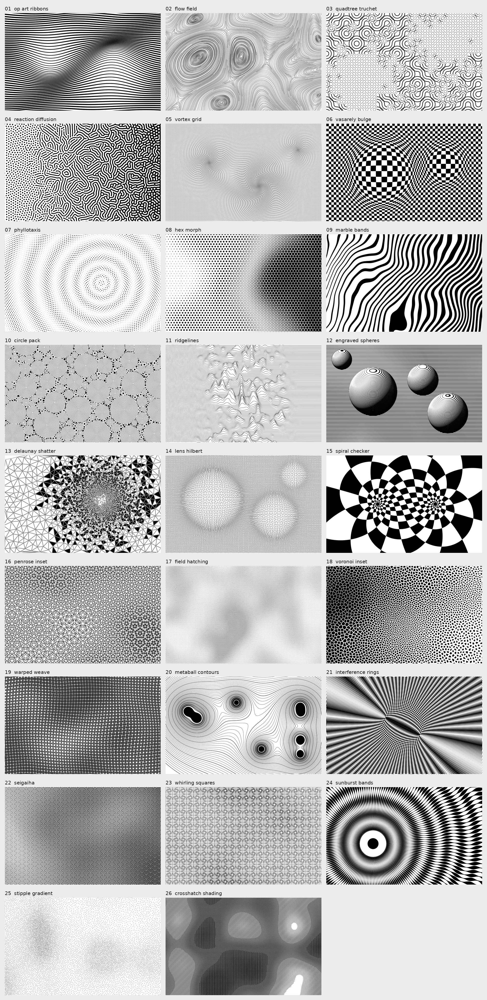

# Silkscreen patterns

A palette of 26 generative black-and-white designs for keyboard PCB silkscreen, shared by every project in this repo. Each pattern changes across the board through flow, warping, density or scale, so no single tile repeats.

All SVGs are 400 × 250 mm with mm units in the viewBox. That covers any keyboard PCB, so you can place, scale and crop a pattern to your outline. Black is ink. The canvas has no background rectangle.

| # | Pattern | What varies | Ink |
| --- | --- | --- | --- |
| 01 | [Op-art ribbons](svg/01_op_art_ribbons.svg) | Bands swell and pinch around two lenses | 48% |
| 02 | [Flow field](svg/02_flow_field.svg) | Evenly spaced streamlines over curl noise | 23% |
| 03 | [Quadtree Truchet](svg/03_quadtree_truchet.svg) | Tiles subdivide toward two attractors, so arcs shrink and thin | 17% |
| 04 | [Reaction-diffusion](svg/04_reaction_diffusion.svg) | Gray-Scott feed/kill sweep: spots, then labyrinth, then holes | 40% |
| 05 | [Vortex grid](svg/05_vortex_grid.svg) | Square lattice pinched and twisted by three wells | 18% |
| 06 | [Vasarely bulge](svg/06_vasarely_bulge.svg) | Checkerboard inflated by two spheres | 50% |
| 07 | [Phyllotaxis ripples](svg/07_phyllotaxis.svg) | Golden-angle dots with concentric size ripples | 6% |
| 08 | [Hex morph](svg/08_hex_morph.svg) | Hexes grow from dots into rings, then solid cells, while rotating | 36% |
| 09 | [Marble bands](svg/09_marble_bands.svg) | Domain-warped stripes, thin lines to fat bands | 40% |
| 10 | [Circle pack](svg/10_circle_pack.svg) | Packed discs: rings, bullseyes or dots by size | 22% |
| 11 | [Ridgelines](svg/11_ridgelines.svg) | Stacked profiles with hidden lines removed, peaks crowd the middle | 14% |
| 12 | [Engraved spheres](svg/12_engraved_spheres.svg) | Engraving lines wrap over spheres and thicken in shadow | 44% |
| 13 | [Delaunay shatter](svg/13_delaunay_shatter.svg) | Triangles shrink and fill toward an impact point | 35% |
| 14 | [Lens Hilbert](svg/14_lens_hilbert.svg) | One continuous Hilbert curve magnified by three lenses | 20% |
| 15 | [Spiral checker](svg/15_spiral_checker.svg) | Log-spiral checkerboard around two poles | 47% |
| 16 | [Penrose inset](svg/16_penrose_inset.svg) | Aperiodic Penrose triangles that swell or shrink with noise | 36% |
| 17 | [Field hatching](svg/17_field_hatching.svg) | Short strokes combed along a field, length and weight varying | 12% |
| 18 | [Voronoi inset](svg/18_voronoi_inset.svg) | Organic cells whose gutters widen across the board | 48% |
| 19 | [Warped weave](svg/19_warped_weave.svg) | Over-under bands of varying width on a warped grid | 61% |
| 20 | [Metaball contours](svg/20_metaball_contours.svg) | Iso-lines of merging point charges around solid cores | 19% |
| 21 | [Interference rings](svg/21_interference_rings.svg) | Checkerboard of two ring families | 48% |
| 22 | [Seigaiha](svg/22_seigaiha.svg) | Overlapping wave scales, ring weight drifting | 46% |
| 23 | [Whirling squares](svg/23_whirling_squares.svg) | Inscribed-square spirals, twist varies per cell | 26% |
| 24 | [Sunburst bands](svg/24_sunburst_bands.svg) | Wobbling rays whose width pulses with radius | 49% |
| 25 | [Stipple gradient](svg/25_stipple_gradient.svg) | Blue-noise dots with density from a noise field | 5% |
| 26 | [Cross-hatch shading](svg/26_crosshatch_shading.svg) | One to three hatch layers by tone | 57% |

Low-resolution previews are in [preview/](preview/).



## Fab limits

Strokes are at least 0.25 mm. Filled features and gaps are designed to be at least 0.3 mm, which clears the usual 0.15 mm silkscreen line minimum at JLCPCB and PCBWay. `check_widths.py` rasterizes each SVG at 0.05 mm per pixel. It reports the share of ink and gap pixels in features narrower than about 0.2 mm, mostly anti-aliasing and the pointed ends of tapering shapes. The last run found under 1.3% for every pattern. The highest were the sharp tips in Penrose inset, the stroke ends in field hatching and the corner wedges in whirling squares.

Filled contours and long polylines are simplified with a 0.02 mm Douglas-Peucker tolerance, which is far below what silkscreen can resolve.

Fabs remove silkscreen over exposed copper and drilled holes, so switch pads, hotswap sockets and the MCU footprint will cut gaps in a pattern. Busy fills like 04, 06, 15 and 19 also compete with reference designators and polarity marks. Keep those marks on the other side or clear a margin around them.

## Using a pattern in KiCad

1. In the PCB editor, choose **File → Import → Graphics**, pick the SVG, set the layer to `F.Silkscreen` or `B.Silkscreen`, and keep the scale at 1. In KiCad 7 and newer, filled patterns import as filled polygons, and line patterns as graphic lines with their stroke width.
2. Move the import so the board sits over the part you want, then delete everything outside `Edge.Cuts`. You can also crop the SVG to your board outline in Inkscape first.
3. Run DRC. KiCad flags silkscreen over pads and outside the board edge.

The vortex grid, flow field, lens Hilbert and implicit fills (12, 19, 21, 22, 26) contain tens of thousands of segments. If KiCad slows down, crop to the board in Inkscape before importing, or convert to a bitmap with the KiCad Image Converter.

## Regenerating

```sh
pip install numpy scipy matplotlib shapely cairosvg pillow
python3 generate.py out                        # all patterns into out/ and out/preview/
python3 generate.py out flow_field hex_morph   # only the named patterns
python3 check_widths.py 'out/*.svg'
```

Each pattern is a seeded function in `generate.py`. To get a different variation of the same design, change its seed or attractor positions. Reaction-diffusion simulates 14,000 steps and takes about four minutes. The others take seconds.
