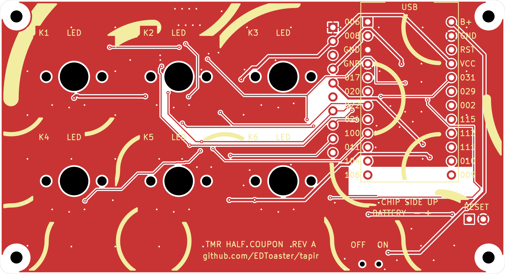

# TMR half test coupon, rev A

A 2 × 3 key test board for the [TMR half](../README.md) keyboard. It carries the same sensor cell, the same multiplexer and the same sensor power switch that the 28-key board would use, so the open questions in [design-decisions.md](../design-decisions.md) can be answered with measurements before the full board is drawn.

**Status: rev A rebuilt for second review; not ordered.** The CAD and CAM gates pass. Nothing has been measured on hardware. Ordering needs the owner's approval ([AGENTS.md](../AGENTS.md)).




The schematic is [tmr-coupon.kicad_sch](tmr-coupon.kicad_sch) ([picture](docs/schematic.png)). The board is [tmr-coupon.kicad_pcb](tmr-coupon.kicad_pcb). Both open in KiCad 10.

## What it tests

| Question | How the coupon answers it |
| --- | --- |
| How strong is the field at rest and at bottom-out? | Six sensor cells at the Partial-Gauss position. T1 compares 1.2 mm and 1.6 mm boards and checks the margin for 0.500 and 0.75 sensitivity. |
| Is the cheap 74HC4067 fast enough? | Both muxes are the CD74HC4067SM96 proposed in D7, wired the way the full board would be. |
| How much does the bypass capacitor matter? | Rail A (K1–K3) has the datasheet 100 nF per sensor. Rail B (K4–K6) has 10 nF. |
| Does the optional output capacitor help or hurt? | K2 and K5 have 100 pF on the sensor output. Their neighbours have empty pads. |
| What does pulsing the sensor power cost? | Each rail has a switch, a 10 Ω current shunt and a voltage monitor. T6 checks when a key reading becomes valid after power-on. |
| Does an RC filter in front of the ADC help? | 0 Ω links and empty capacitor pads sit at both ADC inputs. |
| Does the optional battery path work? | The JST-PH connector feeds the module's B+ pad through Q3 and a slide switch. A warning LED is connected on the battery side of both. |

## How the circuit works

A short tour for someone new to analog circuits.

- **Sensor cell.** Each key has one TMR2617S on the bottom of the board, 4.40 mm south of the switch centre. It has three pins: supply, ground, and an output voltage that moves as the magnet in the switch comes closer. A small capacitor next to it steadies its supply.
- **Multiplexer.** The controller only has three free analog inputs, so a 16:1 analog switch (U7, U8) picks one sensor at a time and connects it to one ADC pin. Four select lines S0–S3 carry a binary address from 0 to 15. Both muxes share the select lines, so both muxes present their selected inputs at once. The SAADC samples the two inputs sequentially.
- **Channel map.** Key inputs on each mux are separated by grounded inputs. Key and ground addresses: Addresses 1, 3 and 5 carry K1/K2/K3 on A and K4/K5/K6 on B. Addresses 0, 2, 4, 6 and 8–15 read ground. Rail-monitor addresses: Both monitors use address 7. Grounded addresses give a zero reading for offset and settling tests.
- **Rail switch.** Q1 and Q2 are P-channel MOSFETs between the module's 3.3 V pin and the two sensor rails. Each 100 kΩ gate pull-down keeps its rail on by default. A high on PWR_A_N or PWR_B_N turns that rail off.
- **Shunt.** Each rail has a 10 Ω current-sense resistor. A reading of 1 mV across it means 100 µA. The expected steady drop is up to about 11 mV: three sensors at up to 300 µA each plus 3.3 V / 20 kΩ = 165 µA for the monitor, or 1.065 mA × 10 Ω = 10.65 mV at nominal values ([MDT datasheet, p. 4](https://www.dowaytech.com/en/res/202408/21/dd53d68876041b0f.pdf), **drawing** plus calculation).
- **Rail monitor.** Two 10 kΩ resistors halve each sensor rail into its MON channel. Use the monitor from the same rail and ADC channel as the key. After subtracting the ground reading from each, divide the key reading by twice the MON reading to get Vout / Vsensor. Sample them close together with the rail on and stable. Skip the calculation if MON is near zero. See [Supply and reference](../analog-readout.md#supply-and-reference).
- **ADC filter pads.** R11 and R12 are 0 Ω links and C19 and C20 are empty. Swap in a resistor and capacitor to try a filter without a new board.

## Pin map

Controller pads as seen from the top with USB at the top edge. Pin names follow the [nice!nano v2 pinout](https://nicekeyboards.com/docs/nice-nano/pinout-schematic/).

| Signal | nRF pin | Pro Micro name | Notes |
| --- | --- | --- | --- |
| S0, S1, S2, S3 | P0.17, P0.20, P0.22, P0.24 | D2, D3, D4, D5 | Mux address, S0 is the low bit |
| MUX_EN_N | P1.00 | D6 | Low enables both muxes. Pulled low by R13, so it can be left alone. |
| PWR_A_N | P0.11 | D7 | High turns rail A off. Leave floating or low for always on. |
| PWR_B_N | P1.04 | D8 | High turns rail B off. Use standard drive and low-frequency switching per the [Nordic pin table](https://docs.nordicsemi.com/r/bundle/ps_nrf52840/page/pin.html) (**drawing**). |
| AIN_A | P0.02 / AIN0 | | Mux A output (K1–K3) |
| AIN_B | P0.29 / AIN5 | | Mux B output (K4–K6) |
| AIN_SPARE | P0.31 / AIN7 | | Only goes to J3 pin 8 |
| VCC | 3.3 V pin | | Supplies the muxes and both rail switches |
| B+ | battery pin | RAW position | From J1 through Q3 and S1. Verify B+ on your actual clone. |

Debug header J3 is vertical, pad 1 nearest the top edge. In pad order: GND, 3V3, SWA (before A shunt), VSA (after A shunt), SWB, VSB, S0, A7, MXB, MXA. The labels are on the bottom.

## Layout

| Item | Value |
| --- | --- |
| Board | 92 × 50 mm, 2 layers, 2 mm corner radius (**drawing**). T1 compares nominal 1.2 mm and 1.6 mm. |
| Keys | 19.05 mm pitch, 3 columns × 2 rows |
| Assembled parts | One-sided assembly on the bottom. 42 placements. |
| Hand-fitted | Controller on the top, six switches pressed in from the top |
| Mounting | Four M2 holes at 3 mm from each corner |
| Antenna | No copper on either layer under the controller's antenna end |
| Battery | J1 opens toward the bottom edge. S1's lever extends 1.00 mm past the edge and its body stops 0.50 mm short (nominal drawing geometry). |
| Decoration | Quadtree Truchet pattern on both silkscreen layers, see [Decorative silkscreen](#decorative-silkscreen) |

Use the same design at both thicknesses for T1. Gateron shows the sensor under a 1.20 mm PCB beside a 1.20 ± 0.05 mm mechanical dimension ([KS-33D drawing, p. 7](https://www.gateron.com/u_file/2603/10/file/GATERONLowProfileMagneticJadeProSwitch-KS-33DD10B060NW-D276.pdf), **drawing**). JLCPCB's [rigid PCB capabilities](https://jlcpcb.com/capabilities/pcb-capabilities) list ±10% thickness tolerance at 1.0 mm and above, so measure the bare edge of each finished board. The switches use locating posts, the battery connector and slide switch are surface mounted, and ordinary soldered headers and M2 fasteners can be sized for either board. Dry-fit everything. Check that the switch bodies sit flat, header pins protrude far enough to solder, locator pegs do not foul the mounts and M2 screws engage without bottoming out. Retention without a plate is still untested.

Design rules used, against [JLCPCB's published limits](https://jlcpcb.com/capabilities/pcb-capabilities) for 2-layer 1 oz boards:

| Rule | This board | JLCPCB minimum |
| --- | --- | --- |
| Track width | 0.20 signal class, 0.40 power class, 0.15 absolute minimum; five signal segments below class width | 0.10 |
| Clearance | 0.20 | 0.10 |
| Via | 0.60 pad, 0.30 hole | 0.25 pad, 0.15 hole |
| Copper to board edge | 0.30 | 0.20 |
| Copper to unplated hole | 0.30 | 0.20 |
| Silkscreen text height | 1.0 | 1.0 |
| Silkscreen line width | 0.15 text strokes; 0.30 thinnest pattern feature | 0.15 |
| Silkscreen to pad | 0.30 for the pattern | 0.15 |

FreeRouting generated the routes. The [analog layout report](reports/analog-layout.json) measures zero analog/control parallel length at less than 0.50 mm same-layer gap and a worst opposite-layer parallel span of 2.889 mm (OUT1/S0). Three nets meet the 80% opposite-layer ground coverage goal. The gate holds each remaining net to its achieved coverage rounded down to a whole percent. MUXA coverage ended lower than on the original route; the new route removes long address-line coupling and improves coverage at both ADC inputs.

| Net | Original coverage (%) | Rebuilt coverage (%) |
| --- | ---: | ---: |
| OUT1 | 74.0 | 67.7 |
| OUT2 | 52.9 | 60.8 |
| OUT3 | 45.2 | 85.0 |
| OUT4 | 42.4 | 78.9 |
| OUT5 | 31.5 | 100.0 |
| OUT6 | 48.0 | 80.8 |
| MUXA | 55.3 | 47.2 |
| MUXB | 54.5 | 65.9 |
| AIN_A | 0.0 | 58.9 |
| AIN_B | 0.0 | 59.1 |

The generated board has 97 two-sided ground stitching vias, two front/eight back filled regions and at least two ties per region. All 17 critical ground pads touch local pour; their longest distance to a through stitch is 1.05 mm. Of 336.369 mm of retained GND trace, 44.313 mm of centreline lies outside a same-layer pour. The fill minimum is 0.20 mm on both layers; the first substantial split in the erosion screen is at 0.240 mm front and 0.200 mm back. These are CAD measurements and a geometry screen, not measurements of etching or electrical performance. T2 through T4 still need physical measurements.

The [mechanical report](reports/mechanical.json) measures 0.3058 mm from the closest sensor land to the Ø5.2 mm hole and a 0.40 mm minimum battery trace width on all three battery positive nets. Mux bypass supply pad centres are 1.75 mm apart; the corresponding ground pad centres are 12.578 mm apart. Both grounds reach local pour and stitching; those distances do not measure the electrical loop length.

## Parts

The full list with part numbers is [bom.csv](bom.csv). The files JLCPCB needs are in [fab/](fab).

| Refs | Part | LCSC | JLC class |
| --- | --- | --- | --- |
| U1–U6 | MDT TMR2617S-AAC-0.500-500, SOT-23-3 | [C55130211](https://www.lcsc.com/product-detail/C55130211.html) | Extended |
| U7, U8 | TI CD74HC4067SM96, SSOP-24 | [C98457](https://www.lcsc.com/product-detail/C98457.html) | Extended |
| Q1–Q3 | AO3401A P-MOSFET, SOT-23 | C15127 | Basic |
| J1 | JST S2B-PH-SM4-TB(LF)(SN) | C295747 | Extended |
| S1 | C&K PCM12SMTR, 300 mA at 6 V DC | [C221841](https://jlcpcb.com/partdetail/CK-PCM12SMTR/C221841) | Extended |
| D1 | KENTO KT-0603R red warning LED | [C2286](https://jlcpcb.com/partdetail/C2286) | Basic |
| R15 | 1 kΩ 0603WAF1001T5E | [C21190](https://jlcpcb.com/partdetail/C21190) | Basic |
| C1–C3, C7, C8 | 100 nF 0603 | C14663 | Basic |
| C4–C6 | 10 nF 0603 | C57112 | Basic |
| C12, C15, C17, C18 | 100 pF C0G 0603 | C14858 | Basic |
| C9 | 1 µF 0603 | C15849 | Basic |
| R1, R2 / R3, R4 / R5, R6 | 100 Ω / 100 kΩ / 10 Ω 0603 | C22775 / C25803 / C22859 | Basic |
| R7–R10, R13 / R11, R12 | 10 kΩ / 0 Ω 0603 | C25804 / C21189 | Basic |

Not fitted on purpose: C11, C13, C14, C16 (output capacitor positions) and C19, C20 (ADC filter capacitors). Paste intentionally remains on these pads for later hand fitting.

You supply and fit by hand:

- The nice!nano v2 clone.
- Six Gateron Low Profile Magnetic Jade Pro switches. [NuPhy](https://nuphy.com/products/gateron-low-profile-magnetic-jade-pro-switches) sells them in packs of 70 or 90.
- Four brass or nylon M2 standoffs and screws. Start with 8 mm or taller (**allowance**). Avoid steel near the magnets. From board coordinates, the nearest mounting hole is H1, 15.207 mm centre-to-centre from K1. The closest S1/J1 metal mounting-land centre is 18.742 mm from K6. This is a PCB measurement, not a magnetic field measurement.
- Optional: a 1-cell LiPo with a JST-PH plug such as [Adafruit 1578](https://www.adafruit.com/product/1578), keycaps, and a 10-pin header for J3.

### Sensor stock

On 2026-11-27, [JLCPCB C55130211](https://jlcpcb.com/partdetail/58850683-TMR2617S_AAC_0_500500/C55130211) showed zero stock, Extended, with a minimum buy of 18. At its displayed estimate of $0.5015 each, 18 cost about $9.03 before any fees or tax. [LCSC C55130211](https://www.lcsc.com/product-detail/C55130211.html) also showed out of stock, with minimum 1, multiple 1, and a reference price of $0.4989 for one. Recheck both listings and the price before buying.

For a fully assembled coupon, pre-order C55130211 in the JLCPCB Parts Library. Wait until your library shows enough available parts for the boards and any assembly allowance shown by JLCPCB. Each board uses six sensors. Eighteen pieces may be insufficient for two assembly orders. JLCPCB keeps pre-ordered parts for PCBA and does not ship them separately. Lead time is unconfirmed.

If you choose to hand-solder the sensors, deselect U1–U6 in the assembly BOM. Source the exact TMR2617S-AAC-0.500-500 from LCSC if it returns to stock, or verify the SOT-23-3 package, 0.500 mV/V/Gs sensitivity and 500 mV/V offset before using [Calero's programmed-to-order TMR2617S option](https://tmr-sensors.com/products/tmr2617). Confirm lead time and total cost before placing a board order. Pins 1 and 2 have 1.10 × 0.60 mm lands and 0.20 mm nominal toe. Pin 3 has a 1.45 × 0.60 mm land and 0.55 mm nominal toe. The toe is calculated from PCB dimensions and the MDT p. 6 lead span. Use a fine tip beside the center hole.

### Decorative silkscreen

Both sides carry a crop of the [quadtree Truchet pattern](../../silkscreen-patterns/) (pattern 03), enlarged so the lines print thicker. It is cosmetic and connects to nothing.

| Item | Value |
| --- | --- |
| Source | `silkscreen-patterns/svg/03_quadtree_truchet.svg`, 400 × 250 mm |
| Zoom | 2×, so the board shows a 46 × 25 mm window of the source |
| Window, top side | Top-left corner at (90, 95) mm in the source |
| Window, bottom side | Top-left corner at (300, 150) mm in the source |
| Stroke widths | 0.78, 1.56 and 2.80 mm (source strokes 0.39, 0.78 and 1.40 mm, **drawing**) |
| Ink | 247.5 mm² in 20 areas on top, 392.2 mm² in 24 areas on the bottom (generated-board measurement) |

Every functional mark takes priority over the pattern. [tools/silk_pattern.py](tools/silk_pattern.py) turns the strokes into filled areas and cuts away anything closer than these distances:

| Kept clear of | Distance (**allowance**) |
| --- | --- |
| Pads, holes, part courtyards and silkscreen lines | 0.30 mm |
| Text labels | 0.45 mm around the label's box |
| Board edge | 0.60 mm |
| M2 mounting holes | The 5.1 mm screw-head courtyard plus 0.30 mm, on both sides |

Gaps between keepouts narrower than 1.0 mm stay empty. Leftover pieces thinner than 0.30 mm, smaller than 4 mm² or shorter than 4.5 mm are dropped. [tools/check_silk.py](tools/check_silk.py) measures the decorative ink on the routed board: 0.299 mm from the closest pad, hole or mark (the 0.30 mm target less polygon rounding) and 0.625 mm from the board edge ([decoration report](reports/silk-clearance.json)). The plotted legend as a whole comes within 0.345 mm on top and 0.425 mm on the bottom ([Gerber read-back](reports/gerber-silk.json)).

Two things to know:

- The six front 14 × 14 mm seating squares exclude all legend ink. The LED cues are outside them.
- Vias are tented. The [silk read-back report](reports/gerber-silk.json) measures 10 via holes under plotted ink on the top and 18 on the bottom.

To change the look, edit `ZOOM` or `CROP` in `silk_pattern.py` and run `tools/build.sh`. Copper is untouched, so no reroute is needed.

## Ordering at JLCPCB

Wait for the owner's approval before buying anything. The proposed comparison is one assembled batch at nominal 1.2 mm and one at 1.6 mm. A cheaper option is one assembled thickness plus bare boards at the other thickness. Populate at least one bare board with the same parts and capacitor options before comparing. Choose at order time.

1. Upload `fab/tmr-coupon-revA-gerbers.zip` for each thickness. Confirm the detected 92 × 50 mm outline and two layers (**drawing**).
2. Set the chosen thickness. [JLCPCB Economic PCB Assembly capabilities](https://jlcpcb.com/capabilities/pcb-assembly-capabilities) list both thicknesses for a single board of this size. Green solder mask and HASL are available for both. Use the same finish and mask for the comparison. Choose “Order Number (Specify Position)” if using the bottom-side placeholder.
3. Turn on Economic PCB Assembly and select **Bottom Side** for the assembled batch or batches. Two or five boards per assembled batch fit the published two-layer green/HASL options.
4. Upload `fab/tmr-coupon-revA-bom-jlc.csv` and `fab/tmr-coupon-revA-cpl-jlc.csv`. Check the fitted lines match the exported BOM: 16 BOM lines.
5. For a complete assembly, stop unless the sensors are available in the JLCPCB parts library for your order. See [Sensor stock](#sensor-stock).
6. Inspect the placement preview before paying. Check mux pin 1 at the triangles, sensors and MOSFETs on their correct pads, the warning LED polarity, and the connector opening and switch lever toward the edge. The build checks exported rotations against the assembler's library pad positions offline. The preview is the final confirmation.
7. If JLCPCB calls for edge rails because of the switch, check that the rails can be removed without striking the actuator. Allow for 1.00 mm nominal lever overhang.

## Assembly and bring-up

### Check your clone before soldering

1. Find the clone's B+ from its pinout or schematic. Compare the physical pad against the coupon footprint with USB pointing toward the same edge. Use continuity with all power removed if you need to confirm a connection. The RAW position alone does not identify a battery input.
2. Power the loose module from USB, with no battery. Measure its 3.3 V/VCC pin against GND and record the voltage. Keep the probes from bridging adjacent pads.
3. With test firmware on the loose module, drive P0.13 high and low and measure VCC in each state. ZMK's [genuine nice!nano v2 board file](https://github.com/zmkfirmware/zmk/blob/main/app/boards/nicekeyboards/nice_nano/nice_nano_nrf52840_zmk_2_0_0.overlay) enables VCC with P0.13 high (**drawing**). Verify your clone's behavior before using the pin. Leave external power enabled for the coupon. If B+ or VCC does not match the footprint, stop before soldering.

### Assembly

1. Inspect the bottom side. U7 and U8 pin 1 at the triangle. No solder bridges on the mux pins.
2. With nothing else attached, measure resistance between J3 pin 1 (GND) and pin 2 (3V3). It should not read as a short.
3. Solder the controller on the top side with its chips facing up and USB at the board edge. Pad 1 (square) is P0.06. Sockets or pin headers are fine.
4. Press the switches in from the top with the LED windows toward the LED marks. With no plate, the locating posts can let a switch lift or tilt. Keep each housing flat against the board, press straight down, and check that it returns to its seat. If needed, hold the housing down from its sides or tack it with removable tape away from the seating surface. Use the same method for both thicknesses.
5. Fit standoffs.
6. Plug in USB. Measure 3.3 V between GND and 3V3 on J3, and about 3.3 V on VSA and VSB.
7. Measure across each shunt from its switch side to its sensor side. Expect up to about 11 mV steady state with the rails on. See the shunt calculation above. On J3, measure SWA (3) minus VSA (4), or SWB (5) minus VSB (6).

### Optional battery

Use a compatible single-cell LiPo. Leave the module's charge-boost jumper open. The genuine nice!nano normally charges at about 100 mA and its boost setting is about 500 mA ([nice!nano FAQ](https://nicekeyboards.com/docs/nice-nano/faq/) and [battery guidance](https://nicekeyboards.com/docs/nice-nano/)). The [documented SuperMini version](https://wiki.icbbuy.com/doku.php?id=developmentboard:nrf52840) lists 100 mA normally and 300 mA with boost. Check both the module and the battery manufacturer's allowed charge current before using battery power. The switch is C&K PCM12SMTR, rated 300 mA at 6 V DC ([manufacturer datasheet, pp. 1–2](https://www.littelfuse.com/assetdocs/littelfuse-ck-slide-pcm-series-datasheet?assetguid=d2f6a96c-7a9a-4c4e-a5aa-4fe3075dffe5), **drawing**); 300 mA would use its entire current rating and 500 mA exceeds it. [JLCPCB C221841](https://jlcpcb.com/partdetail/CK-PCM12SMTR/C221841) showed 7,232 in stock, Extended, minimum one on 2026-11-27.

1. Unplug USB. Set S1 to OFF. Verify the lever positions at the switch terminals with continuity while the board is unpowered. Compare the loose pack contacts with the connector's `+` marking using a meter. JST-PH plugs come wired in both polarities ([SparkFun JST-PH guide](https://learn.sparkfun.com/tutorials/single-cell-lipo-battery-care/jst-ph-connectors)).
2. With USB still unplugged and S1 still OFF, plug in the pack. The reverse-polarity warning LED must stay dark. If it lights, unplug the pack and stop.
3. Confirm with a meter that J1 pin 1 is positive relative to board GND, using accessible pads or test points. A dark LED alone does not prove correct polarity. If the reading is missing, negative or unclear, unplug the pack and investigate. Switch on only after a positive meter reading.

The D1 indicator (KT-0603R) anode goes to GND and its cathode goes through R15 (1 kΩ) to raw J1 pin 1. That lets it light with a reversed pack even while S1 is off. With a reversed 3.0–4.2 V pack the current is roughly 1–2.5 mA (estimated, not a brightness guarantee). With a correctly connected pack, 4.2 V is below the LED's 5 V absolute reverse rating. The datasheet gives up to 5 µA reverse leakage at 5 V and 25 °C ([KENTO, p. 3](https://www.lcsc.com/datasheet/lcsc_datasheet_1810231112_Hubei-KENTO-Elec-KT-0603R_C2286.pdf)). Unplug a reversed pack immediately. Never deliberately test a reversed pack with USB attached.

| Pack and power state | Expected behavior |
| --- | --- |
| Correct pack, S1 on, USB absent | The pack starts powering the module through Q3's body diode. Q3 then turns on and carries the battery current with less voltage drop. |
| Correct pack, S1 on, USB present | The module can charge the pack through the turned-on Q3. Leave boost open and check the pack's allowed charging current. |
| Reversed pack, USB absent | Q3 normally blocks the negative pack voltage from B+. Its body diode is reverse-biased. The warning LED can light with S1 in either position. |
| Reversed pack, USB present, S1 off | S1's open throw isolates the charger B+ path. The raw-pack warning LED can still light. Do not intentionally test a reversed pack with USB attached. |
| Reversed pack, USB present, S1 on | The charger can raise B+ and turn Q3 on. Current can then flow from the charger through Q3 toward the reversed pack. The charger and the impedances of the module, pack and wiring affect that current. No safe current or Q3 dissipation can be claimed for this fault. |
| No pack, USB present | The module should run from USB. Keep S1 off before fitting a pack. With S1 on, some chargers may put voltage on the empty battery connector through Q3. |

Q3 is an AO3401A. Pin 1 is gate, pin 2 source and pin 3 drain; its body diode points from the raw-pack drain toward the switch-side source ([AOS datasheet, pp. 1–2](https://www.aosmd.com/sites/default/files/res/datasheets/AO3401A.pdf), **drawing**). Once on, a 3.0 V cell gives roughly −3.0 V gate-to-source drive. The datasheet specifies up to 85 mΩ at −2.5 V under its room-temperature test condition, equivalent to about 8.5 mV at 100 mA as a nominal design estimate. A 4.2 V cell gives about −4.2 V drive, inside the ±12 V absolute limit. The gate pull-down sets the DC voltage; its exact value mainly affects switching and susceptibility to leakage because a MOSFET gate draws little steady current.

## Test plan

These measurements are still to be made. Record the operator, instrument or firmware revision, supply, ADC settings, fitted capacitors, board thickness and raw data in [design-decisions.md](../design-decisions.md). Treat the numerical test thresholds below as **allowances**. Change them only with a recorded reason. Use settled readings as baselines and record raw counts as well as any corrected readings.

The proposed ZMK build in calibration mode can capture raw counts for T1, T2, T4 and T7. T5 needs a meter and T8 needs a meter and a running USB or ZMK build. A small bare-metal test build is needed for T3 and T6. It should use a timer or busy-wait for short delays, control the rail pins, and save samples in memory before printing. ZMK's mux driver sleeps between selecting and reading and has no rail-control output. USB-only serial logging cannot test battery-only operation; for T7 use battery-safe logging or meter readings of the settled mux outputs and their own rail voltages with USB removed.

| # | Test | Method | Pass or decision |
| --- | --- | --- | --- |
| T1 | Field, direction and board thickness | Measure finished board thickness with a caliper at an accessible bare edge. On each thickness, hold the switch housing flat and read every key at rest and bottomed, with the rail on. Check direction through the stroke. Let `q = Vout / Vsensor` from the same-rail monitor. Estimate field magnitude in gauss as `abs(q − 0.500) / 0.000500` using the nominal sensor calibration. Record the actual direction separately. | Readings change consistently through travel and keep margin from both output limits (approximately 5% and 95% of Vsensor, **drawing**). Compare worst endpoint and smallest travel swing by thickness. Use measured margin to judge whether 0.75 is viable and set `switch-pressed-is-higher` from measured direction. |
| T2 | Noise | Log 1,000 settled samples per key at rest. Compare 100 nF and 10 nF rails, and each 100 pF output-capacitor key with neighbours. Report peak-to-peak and RMS counts, with and without averaging. | Choose the smallest averaging window and capacitor option that keep the observed peak-to-peak noise below half the smallest intended trigger step in counts. Measure scan time with that window. If the trigger step is still unknown, report the minimum defensible step and leave this pass open. |
| T3 | Mux settling | On each mux alternate directly between a bottomed key and an unpressed key at clearly different readings. Separately alternate between a key and a grounded input. Test both directions and the keys with and without the 100 pF output capacitor. Busy-wait after the last address GPIO changes, then trigger the ADC. Sweep from 20 µs down to 1 µs, with a longer reference delay that gives stable readings. Keep ADC acquisition and key positions fixed. | The shortest delay whose repeated mean is within 2 ADC counts of each settled destination in both directions and that adds no repeatable dependence on the previous channel is usable, provided the resulting scan with T2's averaging fits the scan budget. Report noise and uncertainty; if they hide a 2-count shift, the result is inconclusive. |
| T4 | Neighbour crosstalk | Press one key fully while logging each nearest neighbour with its housing held flat. Repeat using a long settle delay to minimise mux history. Compare with T2's idle data. | Repeatable neighbour shifts stay below half the smallest intended trigger step, with noise accounted for. Otherwise estimate the required compensation or revise spacing, retention or layout. |
| T5 | Rail current | With the rails on and settled, measure across both shunts. Multiply millivolts by 100 µA/mV. Subtract the measured rail voltage / 20 kΩ to estimate the current of the three sensors alone. | Results are consistent with up to about 11 mV across each shunt at 3.3 V and up to 900 µA for three sensors, allowing for meter, resistor and supply tolerances. |
| T6 | Pulsed rail and sensor readiness | On each rail, hold one key at rest, then repeat bottomed. Record the long-on baseline. Start each trial from a repeatable off interval and verify the rail discharges as intended. With sampling stopped and S0–S3 low, switch on the rail, select the test key, and trigger its first ADC acquisition at a known time from the rail-enable edge. Try 20 µs steps to 200 µs, then extend or refine the sweep as needed. Repeat each delay from power-off. Scope the rail at J3 if available and repeat with MON as a separate trace. | Use the earliest delay at which the repeated mean key reading and its noise meet the settled T3 and T2 limits at that and all later tested delays. Document supply and bypass values. Pulse only if the measured current savings are useful and wake time plus the measured scan fits the intended interval. |
| T7 | Supply sensitivity | Keep a key fixed and compare stable USB-only and verified battery-only operation. Compare raw key readings, raw MON readings and the corrected key-to-rail ratio. If using a meter, park the mux on the key and measure its output and Vsensor against GND. | The corrected position stays within the T2 step budget across the tested supplies. Report how much the correction helps and the actual voltages tested. |
| T8 | Battery path | Follow the first-connection procedure. With correctly wired pack and USB unplugged, check that S1 enables pack operation and OFF stops it. Confirm USB-only operation with the pack disconnected. Then check for charging with the correctly wired, partly discharged pack and S1 on. Verify charge indication or measured charge current without shorting the pack; leave boost open. | Each power mode works as expected; observed charge current is within both the module/switch rating and the pack's charge limit. The warning LED is dark with the correctly wired pack. Never test a reversed pack with USB attached. |

For T6, the rail and sensor have separate settling times. Using the nominal three sensor bypass capacitors and the roughly 10 Ω shunt-plus-FET path, the simple rail RC estimate is about 3 µs with 100 nF per sensor and 0.3 µs with 10 nF per sensor. The MON divider's 5 kΩ effective output resistance and 100 pF capacitor add about 0.5 µs. These are estimates; the FET's gate transition, loading and the ADC acquisition affect the measured result. The sensor datasheet gives 100 µs maximum power-on time (MDT p. 4, **drawing**). MON can show that the rail voltage has recovered; it cannot show that a key reading has settled. Use a scope for the rail edge itself.

Before switching a sensor rail or the module's 3.3 V supply off, stop ADC sampling and drive S0–S3 low. Keep sampling stopped while the relevant supply is off. Re-enable power before selecting a key and resume readings after the measured wake delay. Leave the mux on its 3.3 V supply when pulsing a sensor rail. If the overall 3.3 V supply is off, keep other signals that reach the mux low or otherwise inactive as well. This avoids feeding unpowered circuitry through a signal pin. See [Circuit rules](../analog-readout.md#circuit-rules-for-the-schematic).

## ZMK starting point

A sketch for [zmk-feature-hall-effect](https://github.com/cr3eperall/zmk-feature-hall-effect) written from its `he,kscan-multiplexer` binding at commit 5ecb125. It has not been built or run.

```dts
/* NRF_SAADC_AIN* comes from <dt-bindings/adc/nrf-adc.h> or nrf-saadc-v3.h, depending on the Zephyr version ZMK pins. */

&adc {
    status = "okay";
    #address-cells = <1>;
    #size-cells = <0>;
    channel@0 {                               /* AIN_A, mux A */
        reg = <0>;
        zephyr,gain = "ADC_GAIN_1_4";
        zephyr,reference = "ADC_REF_VDD_1_4"; /* Full scale follows MCU VDD. Correct with the same-rail MON reading. */
        zephyr,acquisition-time = <ADC_ACQ_TIME(ADC_ACQ_TIME_MICROSECONDS, 10)>;
        zephyr,input-positive = <NRF_SAADC_AIN0>;
        zephyr,resolution = <12>;
    };
    channel@5 {                               /* AIN_B, mux B */
        reg = <5>;
        zephyr,gain = "ADC_GAIN_1_4";
        zephyr,reference = "ADC_REF_VDD_1_4";
        zephyr,acquisition-time = <ADC_ACQ_TIME(ADC_ACQ_TIME_MICROSECONDS, 10)>;
        zephyr,input-positive = <NRF_SAADC_AIN5>;
        zephyr,resolution = <12>;
    };
};

/ {
    kscan0: kscan {
        compatible = "he,kscan-multiplexer";
        address-gpios = <&pro_micro 2 GPIO_ACTIVE_HIGH>, <&pro_micro 3 GPIO_ACTIVE_HIGH>,
                        <&pro_micro 4 GPIO_ACTIVE_HIGH>, <&pro_micro 5 GPIO_ACTIVE_HIGH>;
        address-to-read-delay = <20>;         /* Requested delay in µs; the driver sleeps. */
        calibrate;                            /* prints raw counts per address over the USB console */

        mux_a {
            io-channels = <&adc 0>;
            address-range-min = <0>;
            address-range-max = <7>;
            gnd_a0 {}; k1 {}; gnd_a2 {}; k2 {}; gnd_a4 {}; k3 {}; gnd_a6 {}; rail_a {};
        };
        mux_b {
            io-channels = <&adc 5>;
            address-range-min = <0>;
            address-range-max = <7>;
            gnd_b0 {}; k4 {}; gnd_b2 {}; k5 {}; gnd_b4 {}; k6 {}; gnd_b6 {}; rail_b {};
        };
    };
};
```

D6, D7 and D8 can stay unconfigured: the board's resistors enable the muxes and keep both rails on. Use `calibrate` to log the raw ADC counts. For normal keyboard operation, remove it, add measured calibration values and map only live key addresses to keys. Keep placeholder entries in address order for any gaps in each group's scanned range. Check polarity per mux with T1; the driver takes `switch-pressed-is-higher` at group level. Build and test this sketch before relying on it.

## Rebuilding

Everything is generated from [tools/design.py](tools/design.py) (parts and nets) and [tools/place_board.py](tools/place_board.py) (positions).

```sh
CAM_PYTHON=/path/to/venv/bin/python tools/build.sh  # uses the checked-in routing
CAM_PYTHON=/path/to/venv/bin/python FREEROUTING_JAR=/path/to/freerouting-2.5.0.jar tools/build.sh reroute
```

| Step | Tool | Gate |
| --- | --- | --- |
| Schematic | `check_schematic.py`, KiCad ERC | ERC reports 0 violations; 179 connected pins and 34 nets match the manifest, and 81 manufacturer pin entries match the independent datasheet fixture. This cannot verify the actual clone or circuit behaviour. |
| Board | KiCad DRC, `check_mechanical.py` | 0 violations, 0 unconnected and 0 parity errors. Separately checks courtyard coverage/overlap, centre-hole clearance and battery trace width. These do not check physical switch fit or fabrication tolerances. |
| Analog and thermal | `check_analog.py`, KiCad DRC | Measures coupling, reference coverage, ground ties and a filled-zone neck-width screen. DRC checks for two resolved thermal spokes, with the single solid A1.3 through-hole exception. The analog report lists copper area within 1 mm of each pad for two-pad SMD parts; D1 measures 1.92 vs 0.13 mm². This is not a reflow model. |
| Assembly | `export_fab.py`, `check_cpl.py` | 16 JLC BOM lines, 42 placements; all fit the offline assembler-library pad map, with a worst pad-centre error of 0.217 mm (0.35 mm allowance). Still confirm the final placement preview. |
| Decoration and legend | `check_silk.py`, `check_gerber_silk.py` | Measures decoration clearance and reads all plotted strokes, board edge, switch seats and via ink. Text height is checked against KiCad graphic geometry; Gerber text is plotted as strokes and has no text-height metadata. |
| CAM read-back | `check_cam.py` | Reads copper/mask/paste, drills, outline and fiducials; checks export consistency against KiCad. Cannot validate the physical board. |

Pinned tools: KiCad 10.0.8 (`kicad/kicad:10.0.8` container), FreeRouting 2.5.0 (checksum in `freerouting.sh`) and the Python packages in [CAM requirements](tools/cam-requirements.txt). Reports are in [reports/](reports). `routing/tmr-coupon.ses` is the checked-in route. After changing placements, reroute and review the results; a fresh router run need not match that session. The build reads artwork from `silkscreen-patterns/` at the repo root, so use a full checkout.

Nine footprints are drawn for this project in `footprints.py`: the sensor, magnetic switch, controller, mounting hole, two pin headers, slide switch, reverse LED and fiducial. The sensor position follows [Partial-Gauss](https://github.com/cr3eperall/partialgauss) (credit: cr3eperall); no files were copied from that project. The other five use KiCad 10.0.8 standard footprints with legend adjustments: 0603 capacitor/resistor, SOT-23, SSOP-24 and the JST connector.

## Assumptions and unverified items

- Sensor output direction, rest voltage and field strength are estimates until T1.
- CPL rotations are checked against the assembler's library in the build and still need the placement preview. Confirm the pack's actual polarity during bring-up.
- The switch footprint follows the [Gateron KS-33D drawing](https://www.gateron.com/u_file/2603/10/file/GATERONLowProfileMagneticJadeProSwitch-KS-33DD10B060NW-D276.pdf): Ø5.20 centre hole and two Ø1.70 posts at ±5.08 mm (**drawing**). The posts are symmetric, so the board marks which side the LED window faces.
- Copper to unplated holes is gated at 0.30 mm. Dry-fit the switches and check they sit flat.
- Confirm the clone's B+, VCC and P0.13 operation before soldering. The actual module and its charge current remain unverified.
- No 3D model check was done. Heights were read from datasheets only.
