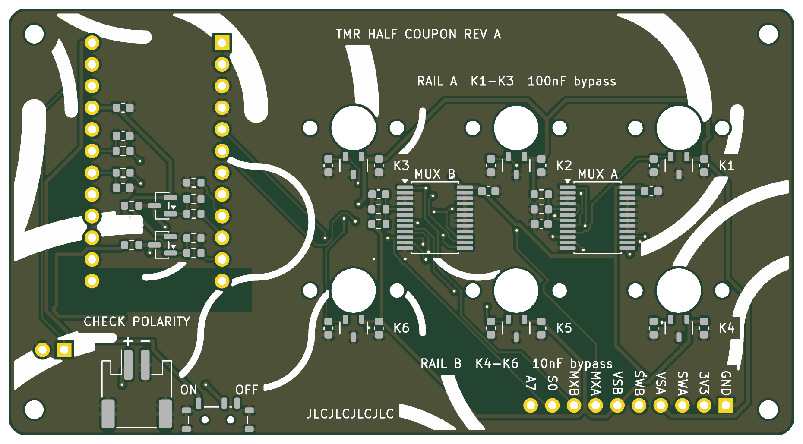

# TMR half test coupon, rev A

A 2 × 3 key test board for the [TMR half](../README.md) keyboard. It carries the same sensor cell, the same multiplexer and the same sensor power switch that the 28-key board would use, so the open questions in [design-decisions.md](../design-decisions.md) can be answered with measurements before the full board is drawn.

**Status: design complete, not ordered, not built.** ERC, DRC and the Gerber readback pass. Nothing here has been measured on hardware yet. Ordering needs the owner's approval ([AGENTS.md](../AGENTS.md)).




The schematic is [tmr-coupon.kicad_sch](tmr-coupon.kicad_sch) ([picture](docs/schematic.png)). The board is [tmr-coupon.kicad_pcb](tmr-coupon.kicad_pcb). Both open in KiCad 10.

## What it tests

| Question | How the coupon answers it |
| --- | --- |
| How strong is the field at the TMR2617S, at rest and at bottom-out? | Six real sensor cells at the Partial-Gauss position. Decides sensitivity 0.5 against 0.75. |
| Is the cheap 74HC4067 fast enough? | Both muxes are the CD74HC4067SM96 proposed in D7, wired the way the full board would be. |
| How much does the bypass capacitor matter? | Rail A (K1–K3) has the datasheet 100 nF per sensor. Rail B (K4–K6) has 10 nF. |
| Does the optional output capacitor help or hurt? | K2 and K5 have 100 pF on the sensor output. Their neighbours have empty pads. |
| What does pulsing the sensor power cost? | Each rail has its own P-MOSFET switch, a 10 Ω shunt to read current, and a divider so firmware can watch the rail rise through the mux. |
| Does an RC filter in front of the ADC help? | 0 Ω links and empty capacitor pads sit at both ADC inputs. |
| Does the optional battery path work? | JST-PH connector and a slide switch into the controller's B+ pin. |

## How the circuit works

A short tour for someone new to analog circuits.

- **Sensor cell.** Each key has one TMR2617S on the bottom of the board, 4.40 mm south of the switch centre. It has three pins: supply, ground, and an output voltage that moves as the magnet in the switch comes closer. A small capacitor next to it steadies its supply.
- **Multiplexer.** The controller only has three free analog inputs, so a 16:1 analog switch (U7, U8) picks one sensor at a time and connects it to one ADC pin. Four select lines S0–S3 carry a binary address from 0 to 15. Both muxes share the select lines, so one address reads a rail A key and a rail B key together on two ADC pins.
- **Channel map.** Address 0, 1, 2 are the three keys of that rail. Address 4 reads half of the rail voltage. Every other address is tied to ground, which gives a known zero for checking settling and offset.
- **Rail switch.** Q1 and Q2 are P-channel MOSFETs between the 3.3 V pin and each sensor rail. A 100 kΩ resistor holds each gate low, so the sensors are powered unless firmware drives PWR_A_N or PWR_B_N high. Firmware that knows nothing about these pins still works.
- **Shunt.** A 10 Ω resistor sits between each switch and its rail. A multimeter across it reads rail current: 1 mV is 100 µA. Expect up to about 1.07 mA per rail (three sensors at up to 300 µA from the [datasheet](https://www.dowaytech.com/en/res/202408/21/dd53d68876041b0f.pdf), plus 165 µA for the monitor divider).
- **Rail monitor.** Two 10 kΩ resistors halve the rail voltage into mux address 4, so firmware can sample how quickly the rail comes up after power-on.
- **ADC filter pads.** R11 and R12 are 0 Ω links and C19 and C20 are empty. Swap in a resistor and capacitor to try a filter without a new board.

## Pin map

Controller pads as seen from the top with USB at the top edge. Pin names follow the [nice!nano v2 pinout](https://nicekeyboards.com/docs/nice-nano/pinout-schematic/).

| Signal | nRF pin | Pro Micro name | Notes |
| --- | --- | --- | --- |
| S0, S1, S2, S3 | P0.17, P0.20, P0.22, P0.24 | D2, D3, D4, D5 | Mux address, S0 is the low bit |
| MUX_EN_N | P1.00 | D6 | Low enables both muxes. Pulled low by R13, so it can be left alone. |
| PWR_A_N | P0.11 | D7 | High turns rail A off. Leave floating or low for always on. |
| PWR_B_N | P1.04 | D8 | High turns rail B off |
| AIN_A | P0.02 / AIN0 | | Mux A output (K1–K3) |
| AIN_B | P0.29 / AIN5 | | Mux B output (K4–K6) |
| AIN_SPARE | P0.31 / AIN7 | | Only goes to J3 pin 10 |
| VCC | 3.3 V pin | | Supplies the muxes and both rail switches |
| B+ | battery pin | RAW position | From the battery through S1 |

Debug header J3, left to right on the top side: GND, 3V3, SWA (rail A before the shunt), VSA (rail A at the sensors), SWB, VSB, MXA (mux A output), MXB, S0, A7.

## Layout

| Item | Value |
| --- | --- |
| Board | 92 × 50 mm, 2 layers, 1.6 mm, 2 mm corner radius |
| Keys | 19.05 mm pitch, 3 columns × 2 rows |
| Assembled parts | 38, all on the bottom, one-sided assembly |
| Hand-fitted | Controller on the top, six switches pressed in from the top |
| Mounting | Four M2 holes at 3 mm from each corner |
| Antenna | No copper on either layer under the controller's antenna end |
| Battery | J1 opens toward the bottom edge. S1's lever sticks out about 1 mm past the edge. |
| Decoration | Quadtree Truchet pattern on both silkscreen layers, see [Decorative silkscreen](#decorative-silkscreen) |

The 1.6 mm thickness is part of the measurement. The field at the sensor depends on the magnet-to-sensor distance, and the Partial-Gauss reference used 1.6 mm.

Design rules used, against [JLCPCB's published limits](https://jlcpcb.com/capabilities/pcb-capabilities) for 2-layer 1 oz boards:

| Rule | This board | JLCPCB minimum |
| --- | --- | --- |
| Track width | 0.20 signal, 0.40 power, two short neck-downs at 0.15 | 0.10 |
| Clearance | 0.20 | 0.10 |
| Via | 0.60 pad, 0.30 hole | 0.25 pad, 0.15 hole |
| Copper to board edge | 0.30 | 0.20 |
| Copper to unplated hole | 0.25 | 0.20 |
| Silkscreen text height | 1.0 | 1.0 |
| Silkscreen line width | 0.15 text strokes; 0.30 thinnest pattern feature | 0.15 |
| Silkscreen to pad | 0.30 for the pattern | 0.15 |

Tracks were placed by FreeRouting 2.5.0 and then checked by KiCad's DRC. The analog traces are short but were not hand-tuned for crosstalk. That is acceptable for a measurement board, and adjacent-key crosstalk is one of the things to measure.

## Parts

The full list with part numbers is [bom.csv](bom.csv). The files JLCPCB needs are in [fab/](fab).

| Refs | Part | LCSC | JLC class |
| --- | --- | --- | --- |
| U1–U6 | MDT TMR2617S-AAC-0.500-500, SOT-23-3 | [C55130211](https://www.lcsc.com/product-detail/C55130211.html) | Extended |
| U7, U8 | TI CD74HC4067SM96, SSOP-24 | [C98457](https://www.lcsc.com/product-detail/C98457.html) | Extended |
| Q1, Q2 | AO3401A P-MOSFET, SOT-23 | C15127 | Basic |
| J1 | JST S2B-PH-SM4-TB(LF)(SN) | C295747 | Extended |
| S1 | SHOU HAN MSK12C02 slide switch | C431540 | Extended |
| C1–C3, C7, C8 | 100 nF 0603 | C14663 | Basic |
| C4–C6 | 10 nF 0603 | C57112 | Basic |
| C12, C15, C17, C18 | 100 pF C0G 0603 | C14858 | Basic |
| C9 | 1 µF 0603 | C15849 | Basic |
| R1, R2 / R3, R4 / R5, R6 | 100 Ω / 100 kΩ / 10 Ω 0603 | C22775 / C25803 / C22859 | Basic |
| R7–R10, R13 / R11, R12 | 10 kΩ / 0 Ω 0603 | C25804 / C21189 | Basic |

Not fitted on purpose: C11, C13, C14, C16 (output capacitor positions) and C19, C20 (ADC filter capacitors).

You supply and fit by hand:

- The nice!nano v2 clone.
- Six Gateron Low Profile Magnetic Jade Pro switches. [NuPhy](https://nuphy.com/products/gateron-low-profile-magnetic-jade-pro-switches) sells them in packs of 70 or 90.
- Four M2 standoffs, 8 mm or taller, so the bottom-side parts clear the desk.
- Optional: a 1-cell LiPo with a JST-PH plug such as [Adafruit 1578](https://www.adafruit.com/product/1578), keycaps, and a 10-pin header for J3.

### Sensor stock

The TMR2617S-AAC-0.500-500 showed zero stock at JLCPCB and LCSC on 2026-11-27. Recheck before ordering. If it is still out:

1. Use JLCPCB's parts pre-order for C55130211 and wait for it to land in your parts library.
2. Or untick U1–U6 in the JLCPCB BOM step and hand-solder six SOT-23-3 parts later. The pads are large enough for an iron.
3. Either way, [Calero](https://tmr-sensors.com/products/tmr2617) sells the TMR2617 programmed to order, which is the fallback source for loose parts.

### Decorative silkscreen

Both sides carry a crop of the [quadtree Truchet pattern](../../silkscreen-patterns/) (pattern 03), enlarged so the lines print thicker. It is cosmetic and connects to nothing.

| Item | Value |
| --- | --- |
| Source | `silkscreen-patterns/svg/03_quadtree_truchet.svg`, 400 × 250 mm |
| Zoom | 2×, so the board shows a 46 × 25 mm window of the source |
| Window, top side | Top-left corner at (90, 95) mm in the source |
| Window, bottom side | Top-left corner at (300, 150) mm in the source |
| Stroke widths | 0.78, 1.56 and 2.80 mm (source strokes 0.39, 0.78 and 1.40 mm, **drawing**) |
| Ink | 355 mm² in 26 areas on top, 384 mm² in 22 areas on the bottom |

Every functional mark takes priority over the pattern. [tools/silk_pattern.py](tools/silk_pattern.py) turns the strokes into filled areas and cuts away anything closer than these distances:

| Kept clear of | Distance (**allowance**) |
| --- | --- |
| Pads, holes, part courtyards and silkscreen lines | 0.30 mm |
| Text labels | 0.45 mm around the label's box |
| Board edge | 0.60 mm |
| M2 mounting holes | The 5.1 mm screw-head courtyard plus 0.30 mm, on both sides |

Gaps between keepouts narrower than 1.0 mm stay empty. Leftover pieces thinner than 0.30 mm, smaller than 4 mm² or shorter than 4.5 mm are dropped, so no stray specks reach the fab. KiCad's DRC checks silkscreen against pads, other silkscreen and the board edge, and reports no violations. [tools/check_silk.py](tools/check_silk.py) then measures the routed board on its own: the nearest ink is 0.298 mm from any pad, hole or mark (the 0.30 mm target less polygon rounding) and 0.625 mm from the board edge ([reports/silk-clearance.json](reports/silk-clearance.json)).

Two things to know:

- The pattern runs under the switch housings and the controller, where the LED and MAG marks already sit. Cured silkscreen ink is usually 15–25 µm thick ([LT Circuit](https://www.ltpcba.com/knowledge-base/pcb-manufacturing-knowledge/silkscreen-design-rules-avoid-common-pcb-silkscreen-mistakes/), **allowance**), which is small beside the switch and magnet tolerances. To clear the seats anyway, set `OPEN_SEAT = ()` in `silk_pattern.py` and rebuild.
- Vias are tented, so the pattern prints over them. Seven via holes sit under ink (five on top, two on the bottom).

To change the look, edit `ZOOM` or `CROP` in `silk_pattern.py` and run `tools/build.sh`. Copper is untouched, so no reroute is needed.

## Ordering at JLCPCB

Stop here until the owner approves the purchase.

1. Upload `fab/tmr-coupon-revA-gerbers.zip`. Check the detected size is 92 × 50 mm, 2 layers.
2. Set thickness 1.6 mm. Any colour and HASL finish are fine. Set "Mark on PCB" to "Order Number (Specify Position)"; the bottom silkscreen has the `JLCJLCJLCJLC` placeholder for it.
3. Turn on PCB Assembly and choose **Bottom Side**. Quantity 2 or 5 assembled boards.
4. Upload `fab/tmr-coupon-revA-bom-jlc.csv` and `fab/tmr-coupon-revA-cpl-jlc.csv`.
5. Confirm all 14 BOM lines match. Deal with U1–U6 as described under Sensor stock.
6. Look at the placement preview before paying. Check that pin 1 of U7 and U8 sits at the small triangle on the silkscreen, that Q1, Q2 and U1–U6 sit on their three pads, and that J1's opening and S1's lever face the board edge. If any part is rotated, fix it in the preview. Selecting "Confirm Parts Placement" asks JLCPCB to check this too.
7. S1's lever overhangs the board edge. If JLCPCB asks to add edge rails for assembly, accept.

The placement file rotations follow the published correction table from [JLCKicadTools](https://github.com/matthewlai/JLCKicadTools) and the bottom-side rule used by [kicad-jlcpcb-tools](https://github.com/Bouni/kicad-jlcpcb-tools). They cannot be proven without JLCPCB's preview, which is why step 6 matters.

## Assembly and bring-up

1. Inspect the bottom side. U7 and U8 pin 1 at the triangle. No solder bridges on the mux pins.
2. With nothing else attached, measure resistance between J3 pin 1 (GND) and pin 2 (3V3). It should not read as a short.
3. Solder the controller on the top side with its chips facing up and USB at the board edge. Pad 1 (square) is P0.06. Sockets or pin headers are fine.
4. Press the six switches in from the top with the LED window toward the "LED" mark. Without a plate they are only held by their posts, so press keys straight down.
5. Fit standoffs.
6. Plug in USB. Measure 3.3 V between GND and 3V3 on J3, and about 3.3 V on VSA and VSB.
7. Measure the voltage across SWA–VSA and SWB–VSB. Expect a few millivolts, 10 mV at most.

Battery, only if you want it:

- There is no reverse-polarity protection, and JST-PH battery plugs are not wired the same way by every seller. With the pack unplugged from the board, check with a meter that the pack's positive contact will land on the pad marked "+". The board follows the Adafruit and SparkFun wiring as far as published descriptions show ([DigiKey forum](https://forum.digikey.com/t/polarity-standard-for-jst-ph-connectors-on-lipo-batteries/64548)); this has not been checked against a physical pack.
- Check which way S1's lever is "on" with a continuity meter between J1 "+" and the controller's B+ pad before trusting the ON and OFF marks.
- On a SuperMini-style clone, confirm that its B+ pad is the battery input before connecting a pack ([nrfmicro wiki](https://github.com/joric/nrfmicro/wiki/Alternatives/)).
- The module charges the cell from USB.

## Test plan

All of these are measurements still to be made. Record results in [design-decisions.md](../design-decisions.md) as **measured**, with the method.

| # | Test | Method | Decides |
| --- | --- | --- | --- |
| T1 | Field and direction | Read each key at rest and fully pressed. Field in Gs = (Vout / VCC − 0.5) / 0.0005. Note whether the reading rises or falls when pressed. | Sensitivity 0.5 or 0.75; `switch-pressed-is-higher` |
| T2 | Noise | 1000 samples per key at rest. Compare rail A (100 nF) with rail B (10 nF), and K2/K5 (100 pF output capacitor) with their neighbours. | Bypass value, output capacitor |
| T3 | Mux settling | Hold one key down. Read the grounded address next to it right after switching, sweeping the delay from 20 µs down to 1 µs. | Scan rate, D7 |
| T4 | Crosstalk | Press one key fully and log its two neighbours. | Whether 19.05 mm spacing needs compensation |
| T5 | Rail current | Millivolts across each shunt. 1 mV = 100 µA. Subtract 165 µA for the divider. | Power budget, D9 |
| T6 | Pulsed power | Scope VSA and VSB on J3 while firmware toggles PWR_A_N and PWR_B_N, or sample address 4 after switch-on. Find the delay before readings are stable. | Whether pulsing is worth it, D9 |
| T7 | Supply sensitivity | Compare readings on USB and on battery. | Whether the ADC reference tracks the sensor rail |
| T8 | Battery path | Run from the pack, confirm S1 disconnects it, confirm USB charges it. | D2 |

T6 needs firmware that drives the two power pins. The ZMK multiplexer driver does not, so T6 waits for the Rust firmware or a few lines of test code.

## ZMK starting point

A sketch for [zmk-feature-hall-effect](https://github.com/cr3eperall/zmk-feature-hall-effect) written from its `he,kscan-multiplexer` binding at commit 5ecb125. It has not been built or run.

```dts
/* NRF_SAADC_AIN* comes from <dt-bindings/adc/nrf-adc.h> or nrf-saadc-v3.h, depending on the Zephyr version ZMK pins. */

&adc {
    status = "okay";
    #address-cells = <1>;
    #size-cells = <0>;
    channel@0 {                               /* AIN_A, mux A */
        reg = <0>;
        zephyr,gain = "ADC_GAIN_1_4";
        zephyr,reference = "ADC_REF_VDD_1_4"; /* full scale = VDD, so readings are ratiometric */
        zephyr,acquisition-time = <ADC_ACQ_TIME(ADC_ACQ_TIME_MICROSECONDS, 10)>;
        zephyr,input-positive = <NRF_SAADC_AIN0>;
        zephyr,resolution = <12>;
    };
    channel@5 {                               /* AIN_B, mux B */
        reg = <5>;
        zephyr,gain = "ADC_GAIN_1_4";
        zephyr,reference = "ADC_REF_VDD_1_4";
        zephyr,acquisition-time = <ADC_ACQ_TIME(ADC_ACQ_TIME_MICROSECONDS, 10)>;
        zephyr,input-positive = <NRF_SAADC_AIN5>;
        zephyr,resolution = <12>;
    };
};

/ {
    kscan0: kscan {
        compatible = "he,kscan-multiplexer";
        address-gpios = <&pro_micro 2 GPIO_ACTIVE_HIGH>, <&pro_micro 3 GPIO_ACTIVE_HIGH>,
                        <&pro_micro 4 GPIO_ACTIVE_HIGH>, <&pro_micro 5 GPIO_ACTIVE_HIGH>;
        address-to-read-delay = <20>;         /* microseconds; sweep this for T3 */
        calibrate;                            /* prints raw counts per address over the USB console */

        mux_a {
            io-channels = <&adc 0>;
            address-range-min = <0>;
            address-range-max = <4>;          /* 0-2 keys, 3 ground, 4 rail monitor */
            k1 {}; k2 {}; k3 {}; gnd_a {}; rail_a {};
        };
        mux_b {
            io-channels = <&adc 5>;
            address-range-min = <0>;
            address-range-max = <4>;
            k4 {}; k5 {}; k6 {}; gnd_b {}; rail_b {};
        };
    };
};
```

D6, D7 and D8 can stay unconfigured: the board's resistors enable the muxes and keep both rails on. Remove `calibrate` and add the calibration values, keymap and input processors once T1 gives real numbers.

## Rebuilding

Everything is generated from [tools/design.py](tools/design.py) (parts and nets) and [tools/place_board.py](tools/place_board.py) (positions).

```sh
CAM_PYTHON=/path/to/venv-with-gerbonara/bin/python tools/build.sh           # uses the checked-in routing
FREEROUTING_JAR=/path/to/freerouting-2.5.0.jar tools/build.sh reroute       # reroutes first
```

| Step | Tool | Gate |
| --- | --- | --- |
| Footprints, project, schematic | `footprints.py`, `project.py`, `schematic.py` | KiCad ERC, 0 violations |
| Netlist check | `check_schematic.py` | Schematic netlist equals the manifest: 170 pins, 31 nets |
| Placement, decoration and routing | `silk_pattern.py`, `place_board.py`, `route_board.py`, `freerouting.sh` | KiCad DRC with schematic parity, 0 violations, 0 unconnected |
| Fabrication files | `export_fab.py`, `bom.py` | 14 BOM lines, 38 placements |
| Decoration clearance | `check_silk.py` | Pattern at least 0.29 mm from pads, holes and marks, 0.59 mm from the edge |
| Readback | `check_cam.py` | Gerbers and drill files parsed with gerbonara and compared with the board: pads, holes, outline |

Pinned tools: KiCad 10.0.8 (`kicad/kicad:10.0.8` container), FreeRouting 2.5.0 (checksum in `freerouting.sh`), gerbonara 1.6.3. Reports are in [reports/](reports). `routing/tmr-coupon.ses` is the accepted routing. Changing a placement means running `reroute`. The build reads the silkscreen artwork from `silkscreen-patterns/` at the repo root, so run it from a full checkout.

Six footprints are drawn for this project in `footprints.py`: the sensor, the switch, the controller, the mounting hole and the two pin headers. The sensor position follows [Partial-Gauss](https://github.com/cr3eperall/partialgauss) (credit: cr3eperall); no files were copied. The other six (0603 parts, SOT-23, SSOP-24, the JST connector and the slide switch) are unmodified copies from the KiCad 10.0.8 standard library.

## Assumptions and unverified items

- Sensor output direction, rest voltage and field strength are estimates until T1.
- The CPL rotations and the battery connector polarity are derived from published conventions, not checked on hardware.
- The switch footprint follows the [Gateron KS-33D drawing](https://www.gateron.com/u_file/2603/10/file/GATERONLowProfileMagneticJadeProSwitch-KS-33DD10B060NW-D276.pdf): Ø5.20 centre hole and two Ø1.70 posts at ±5.08 mm (**drawing**). The posts are symmetric, so the board marks which side the LED window faces.
- Pad-to-hole spacing at the sensor is 0.27 mm, above the 0.25 mm rule and JLCPCB's 0.20 mm minimum, but the tightest spot on the board.
- The clone's VCC pin is assumed to be a 3.3 V regulator output that can supply about 3 mA for the coupon.
- No 3D model check was done. Heights were read from datasheets only.
